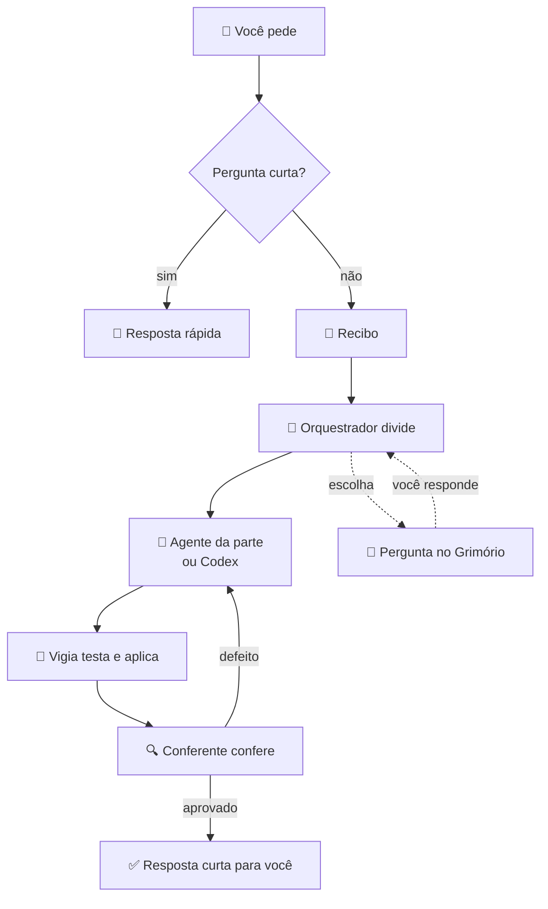

_Escrita pelo Claude a partir da documentação do projeto em 06/10/2026. Pode ler à vontade; se algo estiver errado, anote em 💡 Ideias._

# A equipe

Você fala com **um** só: o orquestrador. Ele funciona como um gerente: entende o pedido, divide o trabalho, cobra quem está fazendo e só te responde depois que alguém conferiu.

## Quem é quem
| Quem | O que faz |
|---|---|
| **Orquestrador** | recebe o seu pedido, faz o pequeno e distribui o grande; responde curto e já conferido |
| **Agentes por parte** | um especialista para cada pedaço do sistema (lista abaixo); cada um lê o caderno da sua parte antes de mexer |
| **Codex** | o programador de trabalho grande e bem descrito; trabalha numa cópia separada e só **propõe** a mudança |
| **Vigia** | pega a proposta do Codex, roda os testes e aplica sozinho se passar (você decidiu em 02/10) |
| **Integrador** | resolve a entrega que o vigia barrou: junta versões em conflito, roda os testes e guarda |
| **Conferente** | o controle de qualidade: **nada chega a você sem ele**. Abre a tela de verdade, roda o caminho real e olha cada imagem |
| **Coordenador** | o "zelador" que fica ligado 24 horas no PC: mantém de pé o app, o bot, o carteiro e a Vila, e religa quem cai |
| **Cérebro do coordenador** | responde em segundos às perguntas curtas ("o app está no ar?"), só lendo, sem mexer em nada |
| **Gerente da equipe** | tira itens da fila e contrata alguém sozinho. Você decidiu ligar (04/10), mas em 05/10 ele ainda estava desligado na prática |

### As partes do sistema (um agente para cada)
- **Publicação:** grade, postagem, registro do que saiu.
- **Builds:** as lutas do Neural Fights.
- **Histórias:** roteiro, imagens, narração e render das histórias.
- **Métricas:** views, retenção e relatórios.
- **App e bot:** o app do celular e o bot do Telegram.
- **Painel e Vila:** o painel do PC, a Vila e o Ateliê de sprites.
- **Jogo zombie:** o jogo dos zumbis.

## Como um pedido seu vira trabalho

- Uma continuação vai para o **mesmo** orquestrador enquanto o pedido estiver vivo. "Novo assunto" no app, ou /novo no Telegram, abre outro.
- Cada pedido mostra em que pé está: recebido, trabalhando, em espera (com o motivo), entregue, conferido, respondido ou falhou.
- Se o Claude estiver proibido ou acima do limite, o pedido fica **em espera** e é retomado a cada 2 minutos.

## O Grimório
- É o **livro das suas decisões**. Fica no app, no objeto 📖 Decidir.
- Cada escolha é uma pergunta com opções e um texto dizendo para que serve. Quando você responde, a resposta vira regra para toda a equipe.
- Uma decisão pode depender de outra. Se você muda uma, as que dependiam dela voltam para você rever.
- Nada se perde: o histórico só cresce.
- **Regra:** decisão sua nunca é pergunta solta no chat. Sempre vira uma escolha no Grimório, e a sua resposta é lida na hora.
- Aqui no Obsidian, as decisões aparecem em [[04 🧭 Decisões/Decisões|🧭 Decisões]].

## A Mesa
- É o painel de comando da equipe. Desde 02/10 ele está espalhado pelo app: **Agora** mostra quem está trabalhando, a fila e o Codex; **Mandar** tem as mensagens e o interruptor do Claude.
- **A fila** é uma lista de cartões. Você arrasta para mudar a ordem.
- **Capacidade:** quantos agentes rodam ao mesmo tempo. Agora são **até 3 em paralelo**. O que você muda no app vira regra (28/09).
- **Teto de uso do Claude:** passou de 50% da janela de 5 horas, para tudo (29/09).
- **Interruptor do Claude:** proibido quer dizer que **só o Claude e os agentes dele param**, num ponto seguro.

## Renovar o chat
Um chat longo piora: esquece decisões, repete erros e deixa entrega parada.
- O chat principal é renovado depois de dois resumos, de umas 4 horas de trabalho, ou quando você disser que está ruim.
- O chat que sai deixa uma **nota de passagem**: o que estava em andamento, o próximo passo e as armadilhas.
- O chat que entra lê essa nota e um **retrato** medido do disco antes de qualquer coisa.

Veja também: [[As IAs que trabalham]], [[App, bot e Obsidian]] e [[Leis do projeto]].
