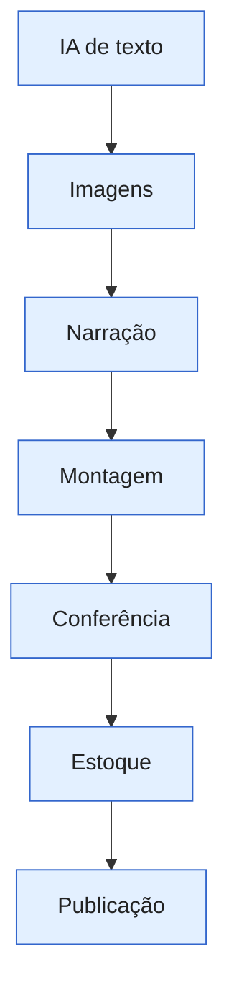

_Escrita pelo Claude. Os números atuais ficam em [[📊 Agora|Agora]]._

# Fluxo das histórias

A [[03 🗺️ Entender o projeto/Glossário#IA de texto|IA de texto]] escreve a série; as imagens e a voz viram uma [[03 🗺️ Entender o projeto/Glossário#Montagem|montagem]] de vídeo em pé. Antes de publicar, o vídeo é conferido.

## Retenção e fila

**Retenção** tem duas leituras: a porcentagem média assistida e os segundos médios vistos. Elas ajudam a comparar vídeos de durações diferentes; não dizem sozinhas se um vídeo é bom. As partes retidas aguardam qualidade; as consertadas já foram ajustadas, mas ainda aguardam nova checagem. Veja [[📊 Agora|Agora]].

## Quando trabalha

A produção de madrugada, entre 01h e 06h, **ainda roda** nesta transição quando o próximo horário precisa de vídeo. A regra futura de produção diurna está decidida, mas ainda não está rodando por inteiro.

Veja [[03 🗺️ Entender o projeto/Como funciona/Publicação|Publicação]] e [[03 🗺️ Entender o projeto/Canais/Histórias|o canal]].