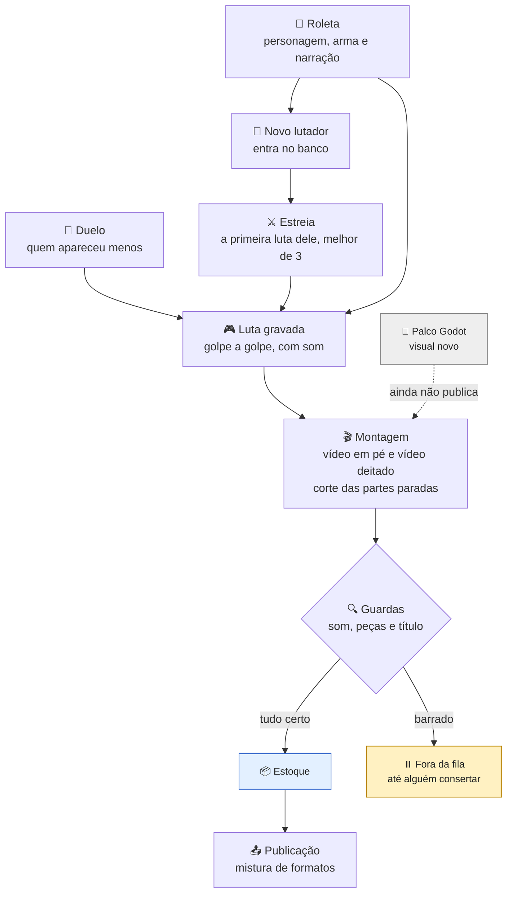

_Escrita pelo Claude a partir da documentação do projeto em 06/10/2026. Pode ler à vontade; se algo estiver errado, anote em 💡 Ideias._

# Fluxo dos builds (Neural Fights)

Como nasce um vídeo de luta, da roleta ao post.

## Cada passo, em palavras
1. **Roleta.** Sorteia um personagem e uma arma, dá uma nota e grava a narração. O vídeo "build" mostra isso e termina com o round decisivo da luta.
2. **Banco de lutadores.** A roleta é a **única** que cria personagem novo. Duelo e estreia só usam quem já está no banco.
3. **Estreia.** Nasce junto com a roleta: é a primeira luta do personagem novo, melhor de 3.
4. **Duelo.** Só a luta, de 20 a 35 s. Luta primeiro quem apareceu menos nos últimos 20 duelos, e nunca se repete um par que já tem vídeo com o mesmo título.
5. **Luta gravada.** O jogo calcula cada golpe. Mesma semente, mesma luta. Desde 28/09 o vídeo sai com o som de verdade do jogo.
6. **Montagem.** Sai em dois formatos: em pé, para o celular, e deitado. As partes paradas da luta são cortadas.
7. **Guardas.** Antes de ir ao estoque, a máquina confere três coisas:
   - a luta tem som? (luta muda é barrada);
   - falta alguma peça?
   - o título já está no ar? (título repetido fica fora).
8. **Publicação.** A cada horário, vence o formato mais atrasado em relação à cota. Ver [[03 🗺️ Entender o projeto/Como funciona/Publicação|Publicação]].

## Quando a fábrica trabalha
| Modo | Quando | O que faz |
|---|---|---|
| Lote | segunda a quarta, 07h–22h | gera até cobrir a semana e o piso; o retrato atual fica em [[📊 Agora]] |
| Reposição | quinta a domingo, 07h–22h | só gera se o canal cair abaixo de 20 vídeos (2 dias) |
| Estoque zero | fora do horário, sem nenhum vídeo | libera tudo até o piso |
| Noite | fora do horário, com estoque | não faz nada |

- **Nada roda na meia hora em volta de cada postagem** (15 min antes e 15 min depois).
- **Com menos de 5 GB livres no disco do sistema, nada novo é gerado.**
- Quem tem **menos dias de estoque** vai primeiro; no empate, o duelo.

## O que vem pela frente
- **Palco Godot.** É um programa de desenho de jogos que vai substituir o traço feito por código. Ele desenha a mesma luta com arte de verdade. Já foi comparado lado a lado com o visual atual: mesmos golpes no mesmo quadro e o mesmo som. A troca do duelo de produção espera o ajuste da corrente.
- **A corrente nova:** a bola agora tem física própria. Decidido em 06/10; ainda não está rodando: falta a arte, o som e a comparação.

Veja também: [[03 🗺️ Entender o projeto/Canais/Neural Fights (builds)|o canal Neural Fights]].
