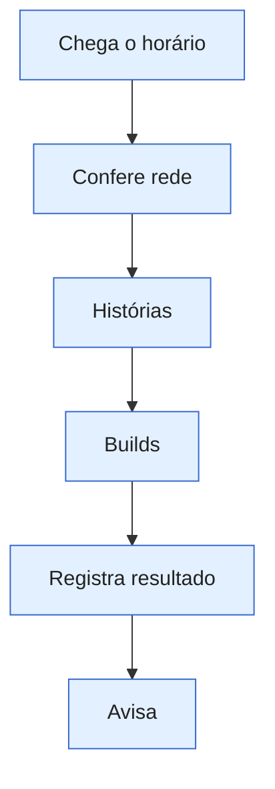

_Escrita pelo Claude. Registros do dia ficam no Diário do sistema._

# Publicação

A publicação escolhe vídeo pronto e tenta postar no YouTube e no TikTok. Não cria vídeo.

A madrugada da grade vai até 00:37; a produção entre 01h e 06h continua nesta transição quando necessária. Falha em um destino não apaga o que saiu no outro. O motivo humano de cada falha fica no diário.

A escolha dos horários e da recuperação está em [[04 🧭 Decisões/Publicação|Decisões de Publicação]].