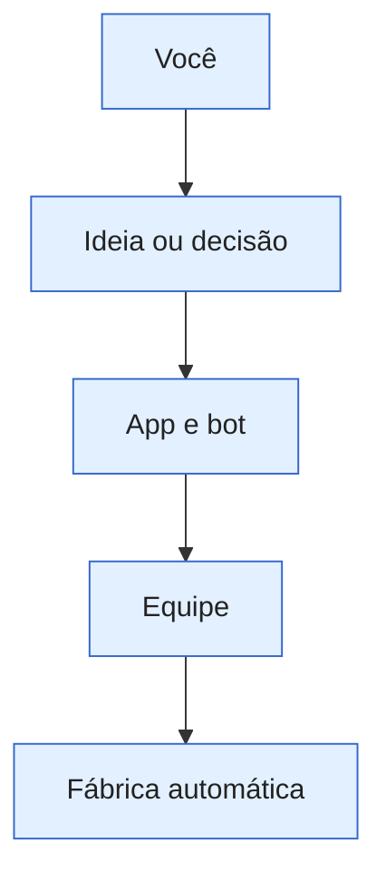
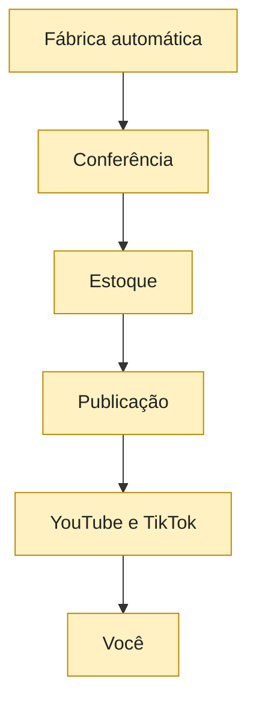

_Escrita pelo Claude. Pode ser reescrita quando o projeto muda; comentários vão em 💡 Ideias._

# O projeto em 1 página

É uma fábrica automática de vídeos curtos. Você escolhe o rumo; a máquina cria, confere e publica. Os números que mudam ficam em [[📊 Agora|Agora]].

## Canais

- [[03 🗺️ Entender o projeto/Canais/Histórias|Histórias]]: séries narradas.
- [[03 🗺️ Entender o projeto/Canais/Neural Fights (builds)|Neural Fights]]: lutas e roletas.
- [[03 🗺️ Entender o projeto/Canais/Zombie|Zombie]]: jogo próprio, ainda sem publicação.

## Escolhas e trabalho

## Vídeos e retorno

A equipe programa e conserta. Quem produz os vídeos é a fábrica automática. Veja [[03 🗺️ Entender o projeto/Como funciona/A equipe|A equipe]], [[03 🗺️ Entender o projeto/Como funciona/Fluxo das histórias|Histórias]], [[03 🗺️ Entender o projeto/Como funciona/Fluxo dos builds|Builds]] e [[03 🗺️ Entender o projeto/Como funciona/Publicação|Publicação]].